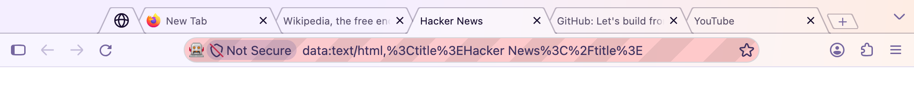
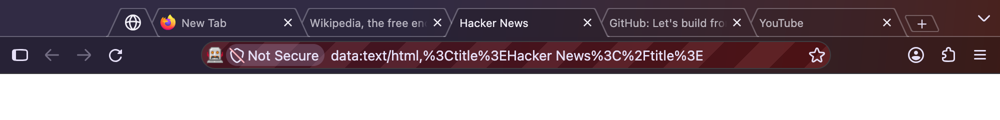
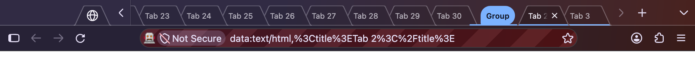

# TrapezoidTabs

Chrome 68's trapezoid tabs for Firefox, as a `userChrome.css`.





The shapes aren't eyeballed. They're Chromium's own M68 paths (branch-heads/3440,
`chrome/browser/ui/views/tabs/tab.cc` and `new_tab_button.cc`) turned into SVG masks:

- 29px tall tabs, 15.5px slanted endcaps with 2px curves top and bottom
- neighbours overlap by 16px, and inactive tabs stack left over right, as Chrome painted them
- the selected tab sits on top and runs into the toolbar with no seam
- full-width tabs are 193px plus the overlap
- Chrome's 36×18 slanted new-tab button, and its red close-button hover

Colours come from your Firefox theme (light, dark, Nova gradient, or an add-on
theme), so it follows theme changes rather than hard-coding Chrome's grey.
Vertical tabs are left alone.

## Install

```bash
./apply.sh
```

Then quit and reopen Firefox. The script:

- copies `trapezoid-tabs.css` into your default profile's `chrome/` folder
- adds `@import url("trapezoid-tabs.css");` to `chrome/userChrome.css` (an
  existing file is backed up first, and the rest of it is left alone)
- sets `toolkit.legacyUserProfileCustomizations.stylesheets` to `true` in
  `user.js`, without which Firefox ignores `userChrome.css`

Other options:

```bash
./apply.sh --list             # show profiles; * is the one Firefox opens
./apply.sh --profile DIR      # pick a profile
./apply.sh --link             # symlink instead of copy, so repo edits apply on restart
./apply.sh --remove           # uninstall
```

Without `--link`, re-run `./apply.sh` after pulling changes.

## Tweaking

The knobs are custom properties at the top of `trapezoid-tabs.css`:

| Variable | Default | |
|---|---|---|
| `--ct-tab-height` | `29px` | Chrome 68's height; the endcap masks stretch to fit |
| `--ct-strip-top` | `8px` | space above the tabs |
| `--ct-tab-max-width` | `209px` | 193 + overlap |
| `--ct-tab-min-width` | `92px` | |
| `--ct-tint` / `--ct-tint-hover` | 50% / 80% toolbar colour | how far inactive tabs lean toward the toolbar colour |
| `--ct-stroke` | 28% of the text colour | outline colour |

To override one without editing the file, put it after the `@import` in
`userChrome.css`:

```css
:root { --ct-strip-top: 4px !important; }
```

## Checking it after a Firefox update

`userChrome.css` hacks depend on Firefox's internal markup, which can change
between releases. `tools/screenshot.mjs` builds a throwaway profile, installs the
stylesheet with `apply.sh`, starts a headless Firefox, opens some tabs and saves a
screenshot of the toolbar. Your real profile isn't touched.

```bash
node tools/screenshot.mjs                    # screenshots/default.png
node tools/screenshot.mjs --theme dark       # light | dark | default
node tools/screenshot.mjs --crowded          # overflowing strip plus a tab group
```

It drives Firefox over Marionette, Firefox's built-in automation protocol, with
no dependencies beyond Node.

## Status

Tested on Firefox 157.0.1 on macOS, with the Nova UI (the default) in light, dark
and system themes: pinned tabs, overflow scrolling and tab groups. Not checked
yet: hover and inactive-window colours (written but not screenshotted),
right-to-left layouts, compact/touch density, split view, and Linux/Windows.
